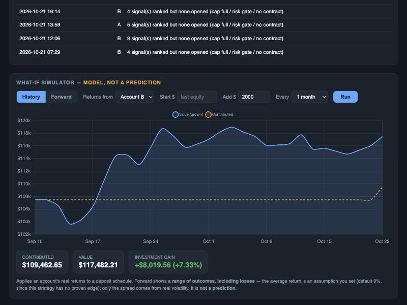
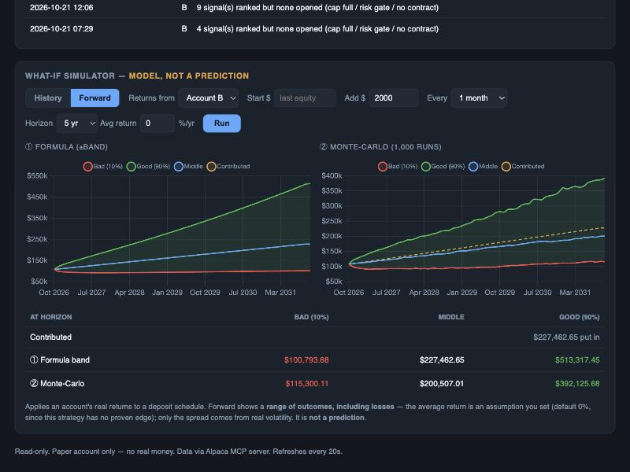

# The What-If Simulator — a very simple tutorial

This is a picture tutorial for the **What-If** box at the bottom of the dashboard.
It's explained in the simplest way possible. 🧸

---

## 🪙 The big idea (in one breath)

Imagine your account is a **piggy bank** that a little robot plays with. Every so often,
**you drop some pocket money in** (say $2,000). The What-If box is a toy that asks:

> *"If you keep adding pocket money, how big could the piggy bank get?"*

That's it. It plays **pretend** with your real numbers.

## 🚦 The one golden rule

**It is NOT a fortune teller.** It never says *"on this day you'll have exactly this much."*
Nobody can know that. Instead it shows a **range** — like a weather person saying
*"it might rain, it might not"* — including the chance things go **badly**. It's a toy
(a "model"), not a promise. 🌦️

## 🔘 There are two buttons: **History** and **Forward**

- **History** = *"let's rewind and watch what already happened."*
- **Forward** = *"let's imagine the days that haven't happened yet."*

---

## ⏪ Button 1 — History ("what already happened")

Click **History**.



Two lines:

- 🟡 **Dashed yellow line = the pocket money you put in.** It only jumps up when you add
  money. (See it step up near the end — that's a $2,000 deposit landing.)
- 🔵 **Blue line = what that money turned into** as the robot played with it.

**The space between the two lines is what the robot *earned* for you.**

The three little cards tell you the same thing in numbers:

- **Contributed** = all the money *you* put in.
- **Value** = what it's worth now.
- **Investment gain** = the robot's part (green = up 😊, red = down 😟).

> In the picture: you put in **$109,462**, it grew to **$117,482** — so the robot added
> about **$8,019** (+7.33%).

---

## ⏩ Button 2 — Forward ("what might happen later")

Click **Forward**. Because nobody knows the future, it does **not** draw one line — it
draws a **fan** of maybes.



There are **two pictures side by side**. They're just **two different friends guessing the
same fan**:

- **① Formula (±band)** = the friend who guesses **fast**, with a ruler. Neat, but a bit
  too tidy.
- **② Monte-Carlo (1,000 runs)** = the friend who is **careful**. He plays the next few
  years over and over — *a thousand times* — with different luck each time, then shows the
  range. (This is how weather forecasts work!)

In **both** pictures, the colours mean:

- 🟢 **Green = a lucky future** (things went well)
- 🔵 **Blue = a middle future** (so-so)
- 🔴 **Red = an unlucky future** (things went badly — you could even end up with **less**
  than you put in!)
- 🟡 **Dashed yellow = the pocket money you put in** (so you can see if you came out ahead)

The **table at the bottom** is just those endings as numbers — each friend's **Bad**,
**Middle**, and **Good** guess.

> Notice the two friends **don't agree** — one friend's lucky case is $513k, the other's is
> $392k. That's **good**! When two honest guesses differ, it reminds you the future is
> *uncertain*, which is the whole point. 🎯

---

## 🎛️ The little knobs (controls)

| Knob | What it means (kid version) |
|---|---|
| **Returns from** | Whose piggy bank to copy — Account A or B |
| **Start $** | How much is in the piggy bank today (leave blank = use the real amount) |
| **Add $** | How much pocket money you drop in each time |
| **Every** | How often you add it (every month, every 2 months…) |
| **Horizon** *(Forward)* | How far into the future to imagine (1, 3, 5, 10 years) |
| **Avg return** *(Forward)* | Your *guess* for the average yearly growth. Starts at **0%** on purpose — because this strategy has **no proven magic**, so we don't pretend it grows on its own. You can change it to see "what if." |

Change a knob, press **Run**, and watch the pictures change. 🕹️

---

## 📂 How to open it

Run the dashboard and scroll to the bottom:

```bash
./run.sh dashboard
```

The **What-If Simulator** box is the last panel on the page.

---

## 🧠 Remember

- It uses your **real** numbers, but it plays **pretend**.
- Forward shows a **range**, never a promise — and it **always shows the bad case too**.
- Green is happy, red is sad, dashed yellow is your own money.
- Two friends guessing = two pictures. If they disagree, that's honesty, not a bug.

That's the whole thing. 🎈
